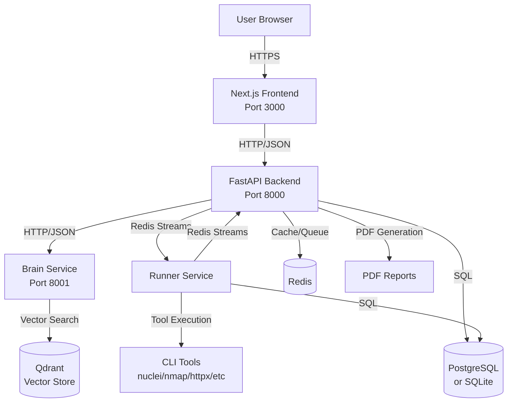
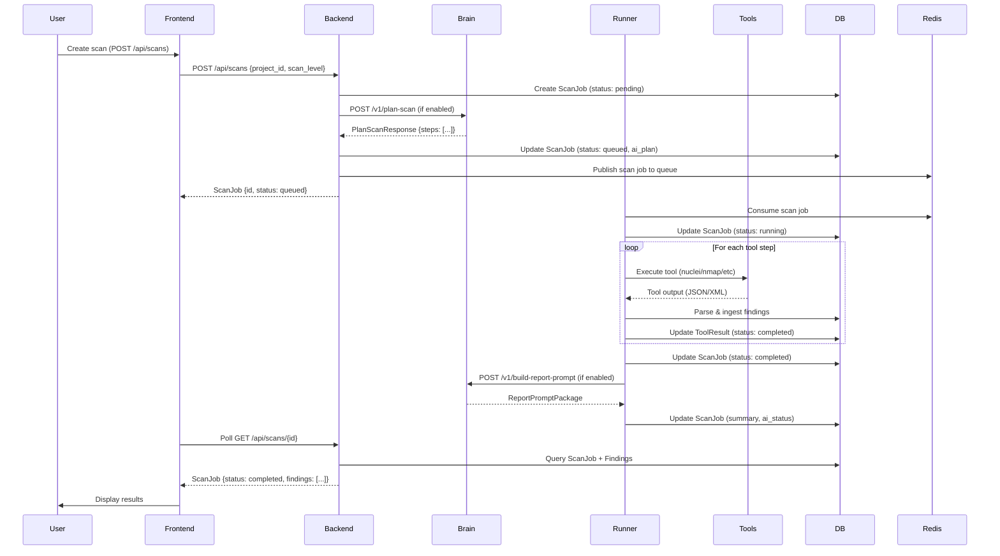
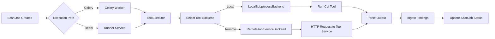

# Thandev Architecture

## Service Architecture

Thandev consists of several independent services that communicate via HTTP APIs and Redis streams:



## Data Flow: Scan Execution

The complete flow from scan request to results:



## Key Services and Directories

### Backend Service

**Location**: `backend/app/`

**Responsibilities:**
- REST API endpoints for frontend
- Scan job creation and lifecycle management
- Findings querying and filtering
- PDF report generation
- Authentication and authorization
- Multi-tenant isolation

**Key Subdirectories:**
- `api/`: FastAPI route handlers
  - `projects.py`: Project CRUD operations
  - `scans.py`: Scan management and results
  - `findings.py`: Findings listing and details
  - `tenants.py`: Tenant plan management
  - `metrics.py`: Dashboard statistics
  - `notifications.py`: User notifications
  - `performance.py`: Performance scan endpoints
- `models/`: SQLAlchemy ORM models
  - `project.py`: Project model
  - `scan.py`: ScanJob model
  - `finding.py`: Finding and ToolResult models
  - `user.py`: User model
  - `tenant.py`: Tenant model
- `services/`: Business logic
  - `scan_orchestrator.py`: Scan execution coordination
  - `findings_ingestor.py`: Tool output parsing and ingestion
  - `pdf_reports.py`: PDF report generation
  - `brain_client.py`: Brain service HTTP client
  - `tools.py`: Tool executor abstraction
- `core/`: Core infrastructure
  - `config.py`: Settings and environment variables
  - `database.py`: Database connection and session management
  - `tenant_utils.py`: Tenant/user authentication helpers

### Brain Service

**Location**: `services/thandev-brain/app/`

**Responsibilities:**
- RAG-powered scan planning
- Report prompt generation
- Finding enrichment (when enabled)

**Key Subdirectories:**
- `api/v1.py`: API endpoints
  - `/v1/plan-scan`: Generate scan plan
  - `/v1/build-report-prompt`: Build report prompt package
  - `/v1/enrich-findings`: Enrich findings with AI (if implemented)
- `planner/`: Scan planning logic
  - `plan.py`: Plan generation using rules + RAG
- `report_prompt/`: Report prompt building
  - `builder.py`: Constructs prompt packages for OpenAI
- `rag/`: RAG infrastructure
  - `store.py`: Vector store interface (Qdrant/PgVector)
  - `embeddings.py`: Embedding provider abstraction
- `catalog/`: Tool catalog
  - `catalog.json`: Tool definitions and modes

### Runner Service

**Location**: `services/thandev-runner/app/`

**Responsibilities:**
- Consume scan step requests from Redis streams
- Execute security tools (nuclei, nmap, httpx, etc.)
- Parse tool outputs and ingest findings
- Publish step results back to Redis streams

**Key Subdirectories:**
- `tasks.py`: Main worker loop and step processing
- `execution/`: Tool execution backends
  - `local.py`: Local subprocess execution
  - `remote.py`: Remote tool service execution
- `ingestion/`: Findings ingestion
  - Direct database writes with tenant context
- `queue/`: Redis stream management
  - `streams.py`: Consumer/producer for Redis streams

### Frontend

**Location**: `frontend/`

**Responsibilities:**
- User interface for all platform features
- Authentication UI (GitHub OAuth)
- Dashboard and analytics
- Scan management and visualization
- Security news and exploit browsing

**Key Subdirectories:**
- `app/`: Next.js App Router pages
  - `projects/`: Project management pages
  - `dashboard/`: Dashboard and scan history
  - `exploits/`: CVE/exploit feed
  - `news/`: Security news aggregation
- `components/`: React UI components
  - `Dashboard/`: Dashboard-specific components
  - `Scans/`: Scan-related components
- `lib/`: Client-side utilities
  - `thandevApi.ts`: API client with auth headers
  - `auth.ts`: NextAuth configuration

### Cloud Run Services (Legacy/Alternative)

**Location**: `cloud-run/`

**Services:**
- `security-scanner/`: Alternative security scanning service
- `lighthouse-scanner/`: Performance scanning service

These are Google Cloud Run job services that can execute scans independently of the main backend/runner architecture.

## Communication Patterns

### HTTP/JSON APIs

**Frontend ↔ Backend:**
- All API calls use JSON request/response
- Authentication via `X-Thandev-User-Id` or `X-Thandev-Tenant-Id` headers
- CORS configured for frontend origin
- Rate limiting via SlowAPI middleware

**Backend ↔ Brain:**
- HTTP/JSON over internal network
- Timeout: 30 seconds (configurable)
- Fallback to Celery-based planning if brain unavailable

**Main API Endpoint Groups:**

1. **Projects** (`/api/projects`)
   - `POST /api/projects`: Create project
   - `GET /api/projects`: List projects with stats
   - `GET /api/projects/{id}`: Get project details
   - `GET /api/projects/{id}/overview`: Project overview with scan history

2. **Scans** (`/api/scans`)
   - `POST /api/scans`: Create scan
   - `GET /api/scans`: List scans
   - `GET /api/scans/{id}`: Get scan details
   - `GET /api/scans/{id}/findings`: Get scan findings (paginated)
   - `GET /api/scans/{id}/report.pdf`: Download PDF report
   - `GET /api/scans/{id}/tools`: Get tool execution statuses
   - `PATCH /api/scans/{id}/cancel`: Cancel running scan

3. **Findings** (`/api/findings`)
   - `GET /api/findings`: List findings (with filters)
   - `GET /api/findings/{id}`: Get finding details
   - `PATCH /api/findings/{id}/status`: Update finding status

4. **Tenants** (`/api/tenants`)
   - `GET /api/tenants/current`: Get current tenant plan info

5. **Metrics** (`/api/metrics`)
   - `GET /api/metrics/dashboard`: Dashboard statistics

### Async Jobs / Callbacks

**Celery Tasks:**
- Backend uses Celery for async scan execution
- Tasks are routed to user-specific queues for concurrency control
- Task: `run_scan_task(scan_job_id, target_url, scan_level, user_id)`

**Redis Streams:**
- Runner service consumes from `scan_step_requests` stream
- Runner publishes results to `scan_step_results` stream
- Consumer groups enable multi-worker scaling
- Per-session concurrency limits prevent resource exhaustion

**Job Status Updates:**
- Backend polls database for scan status
- Frontend polls backend API for status updates
- Real-time updates via polling (WebSocket not currently implemented)

## Data Stores

### PostgreSQL (or SQLite)

**Primary Models:**

- **Project**: Target URLs and metadata
  - `id`, `name`, `target_url`, `owner_id`, `tenant_id`
- **ScanJob**: Scan execution records
  - `id`, `project_id`, `scan_level`, `status`, `summary` (JSON), `stack_info` (JSON)
- **Finding**: Security vulnerabilities/issues
  - `id`, `scan_job_id`, `title`, `severity`, `vuln_type`, `url`, `http_method`, `parameter`
  - Lifecycle: `first_seen_at`, `last_seen_at`, `found_count`, `not_seen_in_latest_scan`
  - Enrichment: `impact_summary`, `remediation_summary`, `remediation_steps`
- **ToolResult**: Tool execution records
  - `id`, `scan_job_id`, `tool_name`, `status`, `output`, `exit_code`, `execution_time`
- **User**: User accounts
  - `id`, `email`, `name`, `github_id`
- **Tenant**: Organization/tenant records
  - `id`, `name`, `plan` (free/basic/pro/enterprise)

**Database Migrations:**
- Alembic for schema versioning
- Location: `backend/migrations/`
- Run with: `alembic upgrade head`

### Redis

**Usage:**
- Caching (optional, via Redis client)
- Task queue (Celery broker/result backend)
- Redis Streams for runner service communication
  - Stream: `scan_step_requests` (step execution requests)
  - Stream: `scan_step_results` (step execution results)

**Configuration:**
- Default: `redis://localhost:6379/0`
- Can be disabled (Celery falls back to in-memory broker)

### Qdrant (Vector Store)

**Usage:**
- RAG knowledge base for Brain service
- Stores embeddings of:
  - CVE descriptions and references
  - Security tool documentation
  - Past scan results (if indexed)
  - Security best practices

**Configuration:**
- Default: `http://localhost:6333`
- Collection: `thandev_rag` (configurable)
- Used only by Brain service, not directly by backend

## Scan Execution Architecture

### Two Execution Paths

**Path 1: Celery + Direct Execution (Current Primary)**
```
Backend → Celery Task → run_scan_for_job() → ToolExecutor → CLI Tools → Findings Ingestion
```

**Path 2: Redis Streams + Runner Service (Alternative)**
```
Backend → Redis Stream → Runner Service → Tool Execution → Findings Ingestion → Redis Stream
```

Both paths:
- Support parallel tool execution
- Respect scan-level tool selection
- Handle timeouts and error recovery
- Ingest findings into the same database schema

### Tool Execution Flow



## Multi-Tenancy Architecture

**Isolation Model:**
- Row-level security via `tenant_id` and `owner_id` foreign keys
- All queries filter by tenant/user
- No cross-tenant data access
- Tenant context passed via HTTP headers (`X-Thandev-Tenant-Id`)

**Data Flow:**
```
User Request → require_tenant() → Tenant Object → Filtered Queries → Tenant-Scoped Results
```

## Security Architecture

**Authentication:**
- GitHub OAuth 2.0 via NextAuth.js
- JWT-based sessions
- Backend validates user via `get_current_user()` dependency

**Authorization:**
- Tenant-based access control
- User can only access their own projects
- All API endpoints require tenant/user context

**Data Protection:**
- Secrets stored in environment variables
- Database connections use connection strings
- No secrets in code or version control

