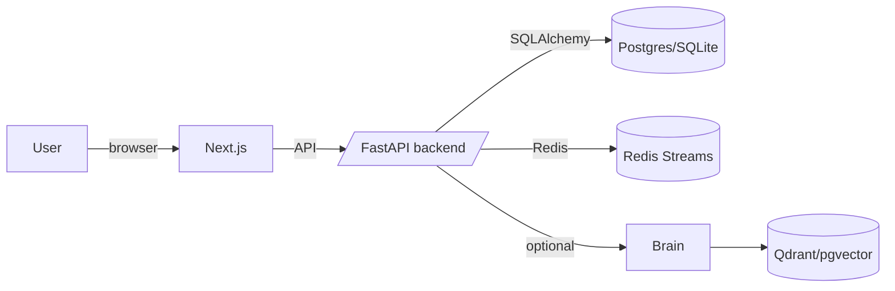
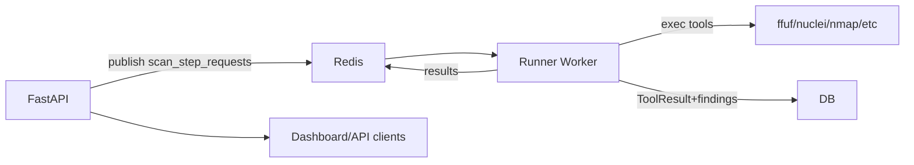
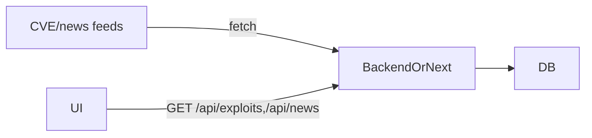

# Thandev System Bible

Authoritative, PDF-ready reference for the Thandev monorepo (updated 2025-12-26). Secrets are intentionally omitted; rotate any discovered credentials.

## Repo Inventory Map
- `/backend` — FastAPI API, scan orchestration, SQLAlchemy models, Alembic, Dockerfile, Fly deploy; includes `presets/`, `payloads/`, legacy folder, and scripts. Runtime: backend.
- `/frontend` — Next.js 14 App Router UI with NextAuth GitHub login, API route proxies, Dockerfile. Runtime: frontend.
- `/services/thandev-runner` — Redis Streams worker executing tools and ingesting findings directly to DB. Runtime: worker.
- `/services/thandev-brain` — FastAPI RAG/LLM planner + enrichment (Qdrant/pgvector). Runtime: backend microservice.
- `/services/tool-services` — Optional ffuf/nuclei micro-APIs with Dockerfiles. Runtime: optional workers.
- `/cloud-run` — Cloud Run job images: `security-scanner/` (Python), `lighthouse-scanner/` (Node Lighthouse variants), `locust-runner/` (load tests), deploy scripts.
- `/packages/thandev_schemas` — Shared Pydantic schemas for planning/reporting.
- `/docs` — Markdown + PDF exports, PDF export script.
- `/scripts` — Setup, verification, scanning helpers; root start/test scripts.
- Root: `docker-compose.yml`, `Makefile`, `vercel.json`, `fly.toml`, start scripts, wordlists, local DB/Redis dumps, prior summary reports.

## What Actually Runs (entrypoints)
- **Frontend (Next.js)**
  - Dev: `cd frontend && npm install && npm run dev` (3000).
  - Prod: Vercel or `npm run build && npm start`; config `vercel.json`.
  - Env: `NEXT_PUBLIC_API_BASE_URL`, `BACKEND_API_BASE_URL`, `NEXTAUTH_URL`, `NEXTAUTH_SECRET`, `GITHUB_CLIENT_ID/SECRET`, optional `NODE_ENV`.
  - Downstream: FastAPI backend; external RSS/news sites for `/api/news`/`/api/article`.
- **Backend API (FastAPI)**
  - Entrypoint `backend/app/main.py`; dev `uvicorn app.main:app --reload --port 8000`; prod via Fly (`fly.toml`) or Dockerfile.
  - Routers: `projects`, `scans`, `tenants`, `users`, `metrics`, `findings`, `findings_batch`, `performance`, `notifications`, `auth_bootstrap`.
  - Env (from `app/core/config.py`): `DATABASE_URL`, `REDIS_URL`, `SECRET_KEY`, `CORS_ORIGINS`, `ENVIRONMENT`, `BRAIN_SERVICE_URL/ENABLED/REQUIRED/TIMEOUT`, `OPENAI_API_KEY`, `USE_CELERY_SCAN_EXECUTION` (default False), scan timeouts/concurrency, tenant auto-create flags, `SELF_SERVICE_SIGNUP_ENABLED`.
  - Downstream: Postgres/SQLite, Redis, optional Brain, Runner via Redis Streams.
- **Runner worker**
  - Entrypoint `services/thandev-runner/app/main.py` → `run_worker_loop()` consuming Redis stream `scan_step_requests`.
  - Start: `cd services/thandev-runner && pip install -r requirements.txt && python app/main.py`.
  - Env: `REDIS_URL`, `DATABASE_URL` (must match backend), `EXECUTION_ADAPTER/USE_EXECUTION_BACKEND`, `MAX_CONCURRENT_STEPS`, `MAX_INFLIGHT_PER_SESSION`, tool/data dirs.
  - Downstream: local tools (ffuf/nmap/nuclei etc.), DB writes, Redis results.
- **Brain service**
  - Entrypoint `services/thandev-brain/app/main.py`; dev `uvicorn app.main:app --port 8001`.
  - Env: `RAG_STORE_TYPE`, `QDRANT_URL`, `DATABASE_URL` (pgvector), `EMBEDDING_PROVIDER/MODEL`, `OPENAI_API_KEY`, `REDIS_URL`.
  - Downstream: Qdrant/pgvector, Redis, OpenAI or sentence-transformers.
- **Cloud Run jobs** (`/cloud-run`)
  - `security-scanner/server.py` (Flask) -> `scanner.py` executes scans, `result_processor.py` handles outputs.
  - `lighthouse-scanner/server*.js` variants for performance scans; `cloudbuild.yaml`.
  - `locust-runner/run_locust.py` for load gen.
  - Deploy via `deploy-*.sh`, `setup-gcloud.sh`.
- **Schedulers/cron**
  - `backend/scheduler.py` and helper scripts for ingestion/recovery; optional Fly scheduler (`fly-scheduler.toml`). Celery present but disabled by default.
- **Tool services**
  - `tool-services/ffuf-service` and `nuclei-service` minimal HTTP wrappers; optional when Runner already covers tools.

## Data Flow & Architecture

## API Contract Map (summary)
- **Auth bootstrap** `POST /api/auth/bootstrap` — maps external (GitHub) to internal UUIDs; returns `{user_id, tenant_id, tenant_plan, created}`. No auth; used by NextAuth JWT callback.
- **Projects** `GET/POST /api/projects`, `GET /api/projects/{id}`, overview; headers `X-Thandev-User-Id` + `X-Thandev-Tenant-Id`.
- **Scans** `POST /api/scans` (create job), `GET /api/scans`, `GET /api/scans/project/{id}`, `GET /api/scans/{id}`, `PATCH /api/scans/{id}/cancel`, `GET /api/scans/{id}/report.pdf`, `GET /api/scans/{id}/tools`. Auth headers required.
- **Findings** `GET /api/findings`, `GET /api/findings/{id}`, `PATCH /api/findings/{id}/status`, `POST /api/findings/batch`. Auth headers required.
- **Performance scans** `POST /api/performance/` (start), `GET /api/performance/{jobId}`. Auth headers required.
- **Metrics/notifications/users/tenants**: health/ready, metrics overview, notifications list/read, tenant info/plan change, user bootstrap/self info.
- **Frontend API (Next.js)**: `/api/security-scan` & status (proxy to backend security-scan), `/api/performance-scan` (proxy), `/api/domains/*` (in-memory TXT verification), `/api/article` readability fetcher, `/api/news` RSS aggregator, `/api/exploits` backend proxy. Auth enforced for domain + scan routes via NextAuth session.
- **Brain service**: `/health`, `/ready`, `/v1/...` routers (planning, enrichment, RAG store).

## Database Model Map (high level)
- `users` — id, email, username, external_provider/user_id, tenant_id, active flags, timestamps. Endpoints: auth bootstrap, users, linked via projects/perf scans.
- `tenants` — id, name, plan (FREE/BASIC/PRO/ENTERPRISE) + limits; relationships to users/projects.
- `projects` — name, target_url, repo_url, description, owner_id, tenant_id; relations to `scan_jobs`, findings, performance_scans.
- `scan_jobs` — project_id, scan_level, status, celery_task_id, brain_session_id, summary JSON, stack_info, ai_plan/status, error_message, timestamps; relations to tool_results/findings.
- `findings` — severity, cve/cwe/cvss, tool/template ids, location fields, evidence/raw_data, dedup fields, remediation + AI enrichment, workflow status; linked to scan_job/project/tool_result.
- `tool_results` — tool_name/version, status/error_code, output/exit_code/previews/meta, timestamps; linked to scan_job and findings.
- `performance_scans` — target_url, scan_level, status, metrics JSON, owner/tenant/project refs, timestamps.
- `notifications`/`audit_logs` — event records; limited exposure.

## Configuration & Environments
- **Backend** (`backend/app/core/config.py`)
  - Required: `DATABASE_URL`, `REDIS_URL`, `SECRET_KEY`, `ENVIRONMENT`, `CORS_ORIGINS`.
  - Optional/flags: `BRAIN_SERVICE_URL/ENABLED/REQUIRED`, `OPENAI_API_KEY`, `USE_CELERY_SCAN_EXECUTION`, `SCAN_RECOVERY_*`, `STALLED_SCAN_*`, `MAX_PARALLEL_TOOLS`, `MAX_SCAN_TIMEOUT_SECONDS`, `TOOL_EXECUTION_TIMEOUT_SECONDS`, tenant auto-create flags, `SELF_SERVICE_SIGNUP_ENABLED`.
  - Dev defaults to Postgres unless env overrides; SQLite only when explicitly set.
- **Runner** (`services/thandev-runner/app/config.py`)
  - Required: `REDIS_URL`, `DATABASE_URL` (match backend).
  - Optional: `EXECUTION_ADAPTER`, `MAX_CONCURRENT_STEPS`, `MAX_INFLIGHT_PER_SESSION`, `CONSUMER_GROUP/NAME`, tool/data dir envs.
- **Brain** (`services/thandev-brain/app/core/config.py`)
  - Required: `RAG_STORE_TYPE`, `QDRANT_URL` or `DATABASE_URL` (pgvector), `REDIS_URL`.
  - Optional: `EMBEDDING_PROVIDER/MODEL`, `OPENAI_API_KEY`, `BRAIN_MAX_*`, session limits.
- **Frontend** (`frontend/env.example`)
  - `NEXT_PUBLIC_API_BASE_URL`, `BACKEND_API_BASE_URL`, `NEXTAUTH_URL`, `NEXTAUTH_SECRET`, GitHub OAuth envs.
- **Cloud Run jobs**
  - Security scanner: target URL + callback/bucket envs (see `cloud-run/security-scanner/server.py`).
  - Lighthouse: uses Cloud Run `PORT`; profile chosen by server variant.
  - Locust: standard Locust envs.

## Used vs Unused Analysis
- **Legacy/low-use areas**
  - `backend/legacy/` and stray `backend/=4.0.0` look archival; safe to archive/remove after confirming no imports.
  - Celery path (`backend/app/tasks/celery_app.py`, `start_celery.sh`) unused when `USE_CELERY_SCAN_EXECUTION=False`; consider removal once runner path is sole strategy.
  - Domain verification Next.js APIs are in-memory only; not persisted or used by backend—either back with DB or delete.
  - Duplicate PDFs under `docs/exports/pdfs`; keep single source in `docs/`.
  - `services/backend/data` is non-runtime sample data; move to `docs/` or storage.
- **Dependencies**
  - Backend requirements largely used; Celery is conditional. Confirm if `sentry-sdk`/`aiohttp` actively used; if not, prune.
  - Frontend: all listed deps referenced; verify real prod need for `@google-cloud/run` (used in `frontend/lib/cloud-run.ts` only if Cloud Run triggers from UI).
- **Dead routes/components**
  - UI uses App Router; ensure `/exploits`, `/news`, `/docs` pages are linked—otherwise consider pruning.
  - Tool services may duplicate runner capability; keep if external network isolation required.

## Security Audit
- **Secrets**: No committed secrets observed; `.env` files must stay gitignored. Replace default `SECRET_KEY="change-me-in-production"` in prod.
- **Auth/headers**: Backend requires UUID headers; frontend `thandevApi` validates UUIDs. Protect reverse proxies to avoid header spoofing; consider JWT between frontend-backend if exposed publicly.
- **CORS**: Configured from env; restrict to prod domains in production.
- **SSRF**: `/api/article` and `/api/news` fetch arbitrary URLs; add allowlist/URL validation and block private IP ranges. Backend scan URLs also need private IP blocking in `_normalize_url` path.
- **Callback/auth**: Runner writes directly to DB; Redis messages unauthenticated—secure Redis network, consider message signing if multi-tenant Redis. Cloud Run callbacks (if used) should include HMAC secret.
- **Domain verification**: In-memory map only; no persistence or ownership binding beyond TXT check. Move to backend + DB with expiry, rate limiting in Redis (current in-memory limiter per user).
- **Rate limiting**: Scans enforce plan quotas + per-hour limit; other APIs lack global rate limiting. Add Redis-based limits to auth bootstrap, findings, news/exploits, and Next API fetchers.
- **Security headers**: Add standard headers (HSTS, X-Frame-Options, CSP) on backend and frontend.
- **Transport**: Enforce HTTPS on Fly/Vercel/Cloud Run.

## Operational Readiness Checklist
- Logging: JSON logging optional; request middleware present. Add structured fields/correlation IDs and central shipping. ◐
- Monitoring: No metrics/APM; add Prometheus/OTel + dashboards. ✖
- Retries/Timeouts: HTTP clients use short timeouts; runner/backends have execution timeouts. Add consistent retry/backoff for Brain/Runner calls. ◐
- Job failure handling: Stalled-scan detection + optional recovery flags; add DLQ/retries for transient tool failures. ◐
- Idempotency: Runner step idempotency + finding dedup via `dedup_key`; keep. ✔
- Migrations: Alembic present; run `alembic upgrade head` for Postgres. ✔
- Tests: Some backend tests; limited coverage. Expand unit/E2E + frontend tests. ◐
- Deployments: Fly (backend), Vercel (frontend), Cloud Run scripts, Dockerfiles. Add CI/CD + health-gated rollout/rollback. ◐

## Current Status vs PDF Requirements
- Existing docs/PDFs (`docs/THANDEV_*` and `docs/exports/pdfs/*`) promise architecture covering backend, frontend, runner, brain, infra/devops, security model, market readiness.
- Code alignment:
  - FastAPI backend with scan orchestration, plan-aware limits, PDF reports ✔
  - Next.js UI with GitHub OAuth + auth bootstrap ✔
  - Runner via Redis Streams + tool ingestion ✔
  - Brain RAG service optional ✔ (but disabled tolerance configurable)
  - Cloud Run job images for security/performance ✔ (optional/legacy)
- Gaps vs expectations:
  - Domain verification not persisted/production-ready.
  - Monitoring/observability largely absent despite production readiness themes.
  - Celery path deprecated—ensure docs emphasize runner-stream path.
  - Callback auth for Cloud Run jobs not enforced by default; add HMAC/allowlist.
  - Duplicate docs/exports; consolidate single source of truth.

## PDF Export
Run `bash docs/export_docs_to_pdf.sh` (or `python generate_thandev_pdf.py`) after review to produce updated PDFs, including this file.

